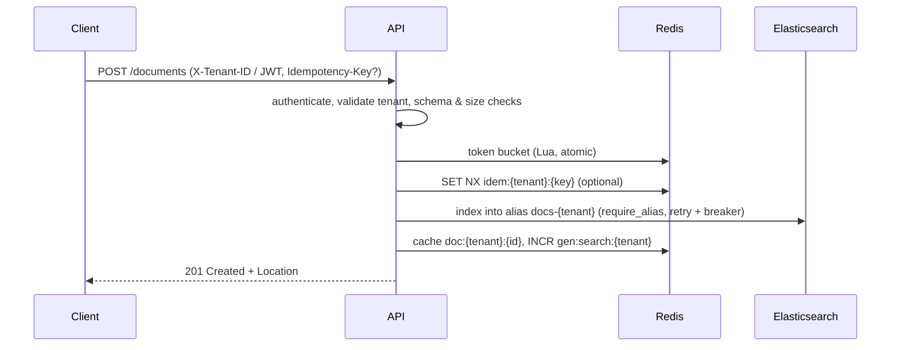
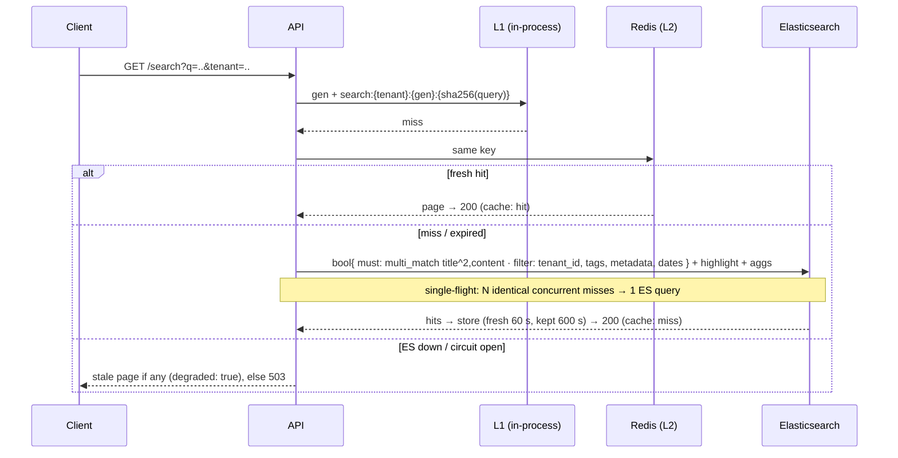

# Architecture: extended reference

[`SUBMISSION.md` §1](../SUBMISSION.md#1-architecture-design) is the concise, 2–3 page architecture document required by the assignment. This file holds the supporting detail: component responsibilities, sequence diagrams, sizing, index design and the decision records behind each choice.

## 1. Components

| Component | Responsibility | Scales by | Failure behaviour |
|---|---|---|---|
| Gateway (nginx / cloud LB) | TLS, L7 load balancing, per-IP flood limit, body cap, request IDs | Replicas | Retries idempotent requests on another API replica |
| Search API (FastAPI) | Auth, tenant resolution, validation, rate limiting, caching, orchestration | Stateless pods (HPA on CPU/RPS) | Readiness fails if search is unreachable; Redis loss only degrades |
| Elasticsearch | Inverted index, BM25, highlighting, aggregations, durable doc copy (prototype) | Data nodes, shards, replicas | Breaker opens → stale reads, 503 writes |
| Redis | L2 cache, token buckets, idempotency keys, tombstones, Streams queue | Redis Cluster | Breaker opens → cache bypass, local rate limiting |
| Indexing workers | Batch indexing from the queue, retries, DLQ | Pods on queue lag (KEDA) | Back off on ES outage without spending retry attempts |

## 2. Sequence diagrams

### Indexing (sync)



### Indexing (async, `INDEXING_MODE=async`)

```mermaid
sequenceDiagram
  participant C as Client
  participant A as API
  participant Q as Redis Streams
  participant W as Worker
  participant E as Elasticsearch
  C->>A: POST /documents
  A->>Q: cache "pending" copy, XADD job
  A-->>C: 202 Accepted (status: pending; GET by id works immediately)
  W->>Q: XAUTOCLAIM stale + XREADGROUP batch
  W->>W: skip tombstoned (deleted-while-queued)
  W->>E: one _bulk request for the batch
  W->>Q: XACK ok · re-queue retryable · DLQ permanent
  W->>W: INCR gen:search:{tenant} for touched tenants
```

### Search



## 3. Sizing

| Quantity | 10M docs (target) | 100x (1B docs) |
|---|---|---|
| Raw text (5 KB avg) | 50 GB | 5 TB |
| Indexed, 1 replica (~1.2x raw x 2) | ~120 GB | ~12 TB |
| Primary shards at 20–40 GB | 2–3 per large tenant index; small tenants in shared routed indices | ~250–400 |
| Peak search QPS | 1,000 | 100,000 |
| ES QPS at 70% cache hits | 300 | 30,000 |
| ES data nodes (driven by QPS, est. 500 QPS/node for this query shape) | 3 (HA minimum) | ~60 + 3 masters + coordinating |
| API processes (measured with real ES: 314 req/s per process on cache misses, 752 on hits; sized on misses at 60% utilisation) | 1,000 / (300 x 0.6) ≈ 6, deployed as 3 pods x 2 workers | ≈ 560, deployed as ~280 pods x 2 workers |

The per-process API throughput is **measured** (docs/BENCHMARKS.md). The ES per-node figure is an **estimate** to validate with `scripts/benchmark.py` against the compose stack and then a production-like cluster.

## 4. Index design

```json
{
  "settings": { "number_of_shards": 1, "number_of_replicas": 1, "refresh_interval": "1s",
    "analysis": { "analyzer": { "document_text": { "type": "custom", "tokenizer": "standard",
      "filter": ["lowercase", "asciifolding", "english_stop", "english_minimal"] } } } },
  "mappings": { "dynamic": "strict", "properties": {
    "tenant_id": {"type": "keyword"}, "document_id": {"type": "keyword"},
    "title": {"type": "text", "analyzer": "document_text", "fields": {"raw": {"type": "keyword"}}},
    "content": {"type": "text", "analyzer": "document_text"},
    "tags": {"type": "keyword"}, "metadata": {"type": "flattened"},
    "created_at": {"type": "date"}, "updated_at": {"type": "date"}, "created_by": {"type": "keyword"} } }
}
```

* **Aliases:** clients only ever use `docs-{tenant}` (`is_write_index`), which points to `docs-{tenant}-v1`. A mapping change means build `-v2`, reindex or replay, then swap atomically.
* **`require_alias=true` on writes**, so a missing alias can never make ES auto-create an index with a guessed mapping.
* **`flattened` metadata**: arbitrary tenant keys without mapping explosion; supports `term` filters and `terms` facets on `metadata.<key>`.
* **Query shape:** `multi_match` (`title^2`, `content`, `best_fields`, `tie_breaker 0.3`), phrase-proximity `should` boosts, and every scoping clause in filter context (cached as bitsets, not scored).

## 5. Tenancy layouts

| Layout | When | Isolation | Cost |
|---|---|---|---|
| `index_per_tenant` (default) | Tens to hundreds of tenants, or large tenants | Physical index per tenant; O(1) offboarding (drop index) | ≥ 1 shard per tenant; cluster-state overhead grows with tenant count |
| `shared_index` | Thousands of small tenants | Logical: `routing=tenant` (one shard per query) + mandatory `tenant_id` filter + composite IDs | Very cheap per tenant; offboarding needs `delete_by_query`; a huge tenant creates a hot shard (use `routing_partition_size`) |
| Dedicated cluster | Regulated, data-residency or very large tenants | Full: separate cluster, keys and network | Highest; billed to the tenant |

Tenants move between tiers by reindexing into the new layout and swapping the alias; the API is unchanged.

## 6. Decision records

**ADR-1: Elasticsearch over PostgreSQL full-text search.**
*Context:* 10M+ docs, relevance ranking, fuzzy/facets/highlighting, 1k+ QPS. *Decision:* Elasticsearch 8. *Consequences:* first-class BM25, horizontal sharding, native advanced search, and mature snapshot/ILM tooling; costs an extra stateful system and gives no multi-document transactions. PostgreSQL FTS would be preferred below about 5M documents, or when search must be transactionally consistent with relational data.

**ADR-2: Index per tenant by default, shared routed index as an option, hybrid at scale.**
*Context:* tenant isolation vs. shard count. *Decision:* both layouts behind one adapter (`ELASTICSEARCH_TENANCY`). *Consequences:* strong isolation by default, plus a documented path to thousands of tenants without cluster-state blow-up.

**ADR-3: Generation-counter cache invalidation.**
*Context:* a write must invalidate every cached query for the tenant; `KEYS`/`SCAN` deletes are O(N) and block Redis. *Decision:* the cache key embeds `gen:search:{tenant}`, and writes `INCR` it. *Consequences:* O(1) invalidation that never touches other tenants; orphaned keys expire by TTL. It is coarse for write-heavy tenants (benchmark: hit ratio 93% → 20% at 10% writes), and the next step is coalescing bumps to the 1 s refresh interval.

**ADR-4: Fail loudly on writes, degrade gracefully on reads.**
*Context:* the original prototype returned 201 for documents it never stored. *Decision:* writes return 503 unless stored; search serves the last good page (`degraded: true`) during an ES outage. *Consequences:* no silent data loss; reads stay available (AP) while writes stay correct (CP-leaning).

**ADR-5: Redis Streams in the prototype, Kafka in production.**
*Context:* async indexing needs a durable queue with consumer groups. *Decision:* Redis Streams now (already deployed for caching), with the queue behind a port. *Consequences:* no extra service for the prototype. Kafka adds replay (reindex from the log), partition ordering per document and higher throughput when needed.

**ADR-6: Token bucket in a Redis Lua script.**
*Context:* per-tenant limits shared by all replicas, with bursts allowed. *Decision:* atomic Lua token bucket (one round trip), falling back to a per-instance bucket if Redis is down. *Consequences:* no read-then-write race, no 2x boundary burst of fixed windows, and limiting continues through Redis outages (less precisely).

**ADR-7: Ports and adapters with explicit in-memory adapters.**
*Context:* the original silently fell back to process-local state. *Decision:* every backend is an interface, and adapters are chosen explicitly by configuration in one composition root. *Consequences:* the full suite runs in seconds without Docker; multi-replica deployments can't accidentally run on per-process state.
